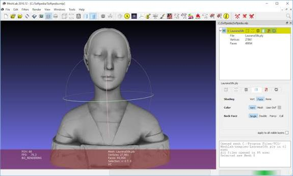
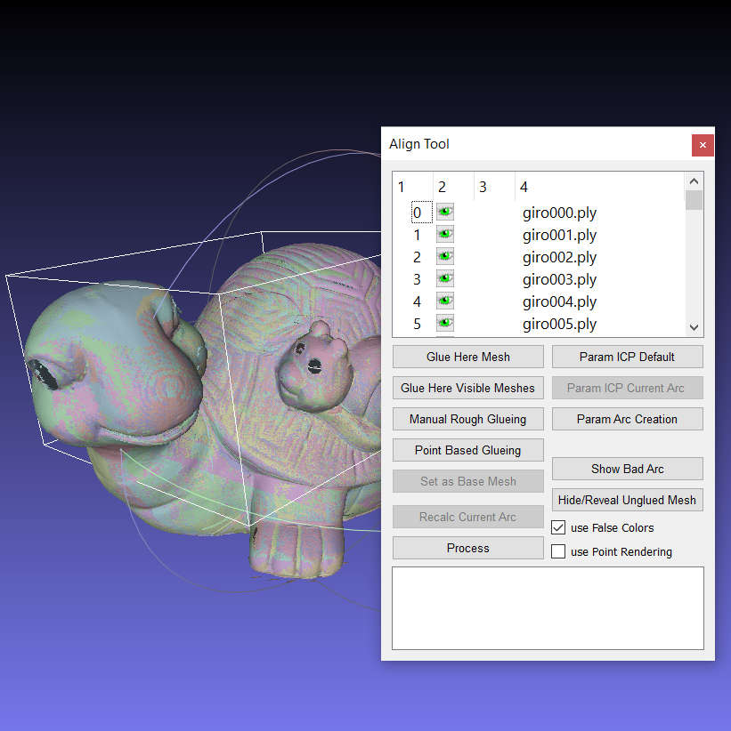
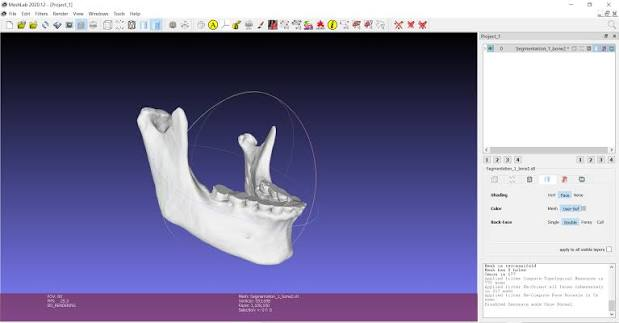

# MeshLab for Cleaning and Simplifying Scanned Geometry

Use MeshLab to turn an unwieldy scan into a model whose geometry you can inspect, reduce, and exchange.
The meshlab software workspace combines interactive filters with layers, surface inspection, and export tools.
The supplied [ML_VERSION](ML_VERSION) identifies the MeshLab snapshot as `2025.07`.

[](https://meshlab-3d.github.io/meshlab-software/)

## Identify what the scan actually contains

A dense model can be a point cloud, a connected surface, or several disconnected fragments.
Those inputs need different treatment, even when they look similar in a shaded viewport.

| Input evidence | Geometry present | Suitable next decision |
| --- | --- | --- |
| Samples without connecting triangles | Point cloud | Review sampling and normals before reconstruction |
| Triangles with open boundaries | Open surface | Decide which openings are missing data |
| Small disconnected surface islands | Fragmented mesh | Separate real parts from scanning debris |
| Dense connected triangles | Detailed surface | Establish a reduction budget and preserve a reference |

Turn on a wireframe view when shading hides the underlying structure.
Check the model dimensions against a known measurement, particularly before transferring it to a printing workflow.
Retain the untouched input so later comparisons have a stable reference.

For meshlab 3d work, the visible result and the topology are separate things to inspect.
A smoothly shaded object can still contain duplicated faces, disconnected components, or unwanted openings.

## Remove redundant geometry without erasing evidence

Start meshlab mesh processing with operations whose effects you can explain.
Duplicate vertices and duplicate faces are different problems; merging vertices does not automatically establish a clean surface.

The following PyMeshLab recipe assumes an existing triangular mesh named `scan.ply`.
It writes a separate output and leaves the original file available for comparison.

```python
import pymeshlab

meshes = pymeshlab.MeshSet()
meshes.load_new_mesh("scan.ply")
meshes.meshing_remove_duplicate_vertices()
meshes.meshing_remove_duplicate_faces()
meshes.meshing_remove_unreferenced_vertices()
meshes.save_current_mesh("scan-clean.ply")
```

These operations follow the [PyMeshLab filter reference](https://pymeshlab.readthedocs.io/en/latest/filter_list.html).
Unreferenced-vertex removal is appropriate here because the input is a surface mesh; on a point-only cloud it would remove the samples.
Check whether merging coincident vertices joined boundaries that were intentionally separate.



- Remove isolated fragments only after identifying which pieces belong to the object.
- Inspect narrow gaps before applying a proximity-based merge.
- Keep a record of filters and parameter values for each saved intermediate result.
- Compare geometry with the reference rather than relying on a cleaner shaded appearance.

## Spend triangles where the shape needs them

Simplification is useful when dense scans slow inspection or exceed a downstream application's practical limits.
Choose the target according to the smallest feature that must remain recognizable.

This independent PyMeshLab example reduces the cleaned mesh toward 50,000 faces while requesting boundary and topology preservation.
Use an input with more faces than the target, and inspect the actual result.

```python
import pymeshlab

meshes = pymeshlab.MeshSet()
meshes.load_new_mesh("scan-clean.ply")
meshes.meshing_decimation_quadric_edge_collapse(
    targetfacenum=50000, preserveboundary=True, preservetopology=True
)
meshes.save_current_mesh("scan-light.ply")
```

Preservation constraints can prevent the requested face count from being reached.
Inspect the silhouette, thin features, sharp transitions, and open edges after reduction.
For textured objects, evaluate the texture-aware decimation filter rather than assuming this geometry-only recipe preserves UV seams.



A lower triangle count is an intermediate measurement.
The useful result is a smaller model that still meets the intended geometric and visual requirements.

## Reconstruct missing surfaces with a stated assumption

A meshlab mesh repair task may involve an accidental hole, but an opening can also be a real feature.
Decide which case applies before adding triangles.

For meshlab 3d scanning data, surface reconstruction starts from assumptions about the samples and their normals.
Poisson reconstruction and ball pivoting address different sampling conditions; compare their results on the same input region.

1. Inspect sample density around the intended surface.
2. Estimate or review normals and their orientation.
3. Reconstruct a trial surface with documented parameters.
4. Examine thin structures and areas with little supporting data.
5. Compare the reconstruction against the original samples.



Hole filling can create a plausible patch where the scanner captured no surface.
Mark that distinction when the model supports measurement, documentation, or research.
A closed surface alone does not prove dimensional accuracy or freedom from self-intersections.

## Check the exported model in its destination

Choose an exchange format according to the information the next tool needs.
STL carries triangle geometry without the richer material information available in other formats.
PLY is useful for exchanging geometry and supported vertex attributes; OBJ workflows may depend on accompanying material and image files.

Reopen the exported output and verify dimensions, orientation, component count, and appearance.
Where the MeshLab executable is available as `meshlab`, open the reduced example from a terminal:

```bash
meshlab scan-light.ply
```

This opens the graphical application; use PyMeshLab when filters must run as a scripted processing sequence.
The supplied [meshlab.desktop](scripts/Linux/internal/snap/meshlab.desktop) records the file-opening integration used by the Snap package.
The root [snapcraft.yaml](snapcraft.yaml) still declares `2022.02`, so its package metadata should not be read as the version of every supplied file.

## Reproduce the application environment behind a result

When sharing filter results, record the application version and relevant plugin availability alongside the mesh.
A source build and a packaged release can differ in available dependencies and filters.
The root [CMakeLists.txt](CMakeLists.txt) declares MeshLab options, including the optional double-scalar build.
The scripts overview [README.md](scripts/README.md) describes the separate build and deployment stages.

Platform-specific references identify how an application package is assembled:

- Linux guidance: [README.md](scripts/Linux/README.md), with [1_build.sh](scripts/Linux/1_build.sh) for compilation and [2_deploy.sh](scripts/Linux/2_deploy.sh) for deployment.
- Linux package stages: [2b_deb.sh](scripts/Linux/internal/2b_deb.sh) and [2d_appimage.sh](scripts/Linux/internal/2d_appimage.sh) produce different distribution formats.
- Windows guidance: [README.md](scripts/Windows/README.md), with [1_build.sh](scripts/Windows/1_build.sh) and [2_deploy.sh](scripts/Windows/2_deploy.sh) describing the corresponding stages.
- Windows distribution stages: [2a_portable.sh](scripts/Windows/internal/2a_portable.sh) prepares the portable layout, while [2c_installer.sh](scripts/Windows/internal/2c_installer.sh) handles the installer stage.
- macOS guidance: [README.md](scripts/macOS/README.md), with [1_build.sh](scripts/macOS/1_build.sh) and [2_deploy.sh](scripts/macOS/2_deploy.sh) covering compilation and deployment.
- macOS distribution stages: [2a_appbundle.sh](scripts/macOS/internal/2a_appbundle.sh) assembles the application bundle, and [2d_dmg.sh](scripts/macOS/internal/2d_dmg.sh) handles disk-image packaging.

Some script documentation describes older platform requirements.
Use the requirements associated with the release you are reproducing; older notes do not establish current architecture support.
The supplied [LICENSE.txt](LICENSE.txt) contains the GNU GPL version 3 license text.

## Related Search Terms

meshlab software, meshlab 3d, meshlab mesh processing, meshlab mesh repair, meshlab 3d scanning, mesh-processing, mesh-editing, mesh-simplification, 3d-scanning, 3d-reconstruction, point-cloud, triangle-mesh, 3d-printing, geometry, python
